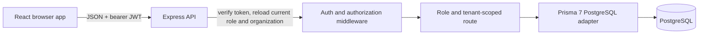

# CampusFlow Pro

CampusFlow Pro is a role-based campus workspace. Students, faculty, and organization administrators use a React application backed by an Express API, Prisma, and PostgreSQL. The existing backend and database schema are retained; this guide describes how to run and verify them safely.

## How a request reaches the database



The browser controls navigation and form visibility for convenience. Express checks the user and their current organization for protected requests. New public registrations are STUDENT accounts in the configured default organization. Platform organization management uses a separate server-only credential.

## Main modules

- Authentication: student registration, bcrypt password hashes, one-hour JWT login, current profile, and logout by clearing the in-memory browser session.
- Organization and departments: current campus details and organization-scoped department browsing; administrators can manage departments.
- People and courses: safe directory profiles, course management, student enrollment, capacity enforcement, and course rosters.
- Attendance: student attendance history, authorized session/record management, and course summaries.
- Projects: projects, collaborators, tasks, status changes, comments, and notifications.
- Dashboards: role-scoped counts and status summaries from the API.
- Documents: safe metadata listing only. Private upload/download storage is not configured.

## Roles

| Role | Main permissions |
| --- | --- |
| `STUDENT` | Browse published courses, enroll and cancel enrollment, view personal attendance, and work in projects they own or joined. |
| `FACULTY` | View assigned courses and their rosters, manage attendance for assigned courses, and access student directory profiles. |
| `ADMIN` | Manage users, departments, and courses inside their organization and perform organization-scoped attendance and project administration. |
| Platform administrator | Use `PLATFORM_ADMIN_SECRET` from trusted server-side tools for global organization management. This is not a browser role. |

These summaries do not replace route-level API authorization. A role shown in client state cannot grant server access.

## Requirements and environment

Use Node.js 20 or newer and PostgreSQL. The backend needs a `.env` file with these variables:

| Variable | Purpose |
| --- | --- |
| `DATABASE_URL` | Existing PostgreSQL connection string. |
| `JWT_SECRET` | HS256 signing key of at least 32 UTF-8 bytes. |
| `DEFAULT_ORGANIZATION_ID` | Existing organization that receives new student registrations. |
| `PLATFORM_ADMIN_SECRET` | Independent server-only key of at least 32 bytes. |
| `PORT` | API port; defaults to `5000`. |
| `FRONTEND_ORIGINS` | Exact comma-separated browser origins; local Vite origins are allowed by default. |
| `AUTH_RATE_LIMIT_WINDOW_MS` | Authentication rate-limit window; defaults to `900000` milliseconds. |
| `AUTH_RATE_LIMIT_MAX` | Login and registration requests per IP in that window; defaults to `20`. |

Copy the example only when no backend `.env` exists. Keep any existing `.env` and database credentials. The frontend has only public API URL configuration in `frontend/.env.example`; never put backend secrets in `VITE_*` variables.

### Enter server secrets privately in PowerShell

The following prompts hide input and place the values only in the current PowerShell process environment. They do not print the values or edit `.env`. Run them in the same terminal that starts the backend:

```powershell
function Set-CampusFlowPrivateSecret {
    param([ValidateSet('JWT_SECRET', 'PLATFORM_ADMIN_SECRET')][string]$Name)
    $secureValue = Read-Host "Enter $Name" -AsSecureString
    $pointer = [Runtime.InteropServices.Marshal]::SecureStringToBSTR($secureValue)
    try {
        $plainValue = [Runtime.InteropServices.Marshal]::PtrToStringBSTR($pointer)
        if ([Text.Encoding]::UTF8.GetByteCount($plainValue) -lt 32) {
            throw "$Name must be at least 32 UTF-8 bytes."
        }
        [Environment]::SetEnvironmentVariable($Name, $plainValue, [EnvironmentVariableTarget]::Process)
    }
    finally {
        [Runtime.InteropServices.Marshal]::ZeroFreeBSTR($pointer)
        $secureValue.Dispose()
        Remove-Variable plainValue -ErrorAction SilentlyContinue
    }
}

Set-CampusFlowPrivateSecret JWT_SECRET
Set-CampusFlowPrivateSecret PLATFORM_ADMIN_SECRET
```

Use two different random values. Stop the backend before clearing these terminal-only values:

```powershell
Remove-Item Env:JWT_SECRET, Env:PLATFORM_ADMIN_SECRET -ErrorAction SilentlyContinue
```

Changing `JWT_SECRET` invalidates tokens signed with its previous value. Tokens otherwise expire after one hour; there is no immediate per-user revocation mechanism.

### Check the configured registration organization without showing credentials

From `backend`, this read-only check uses the existing `DATABASE_URL` and prints only whether the configured organization exists and whether it is the expected GAT slug:

```powershell
@'
const prisma = require("./src/prisma");
(async () => {
  const org = await prisma.organization.findUnique({
    where: { id: process.env.DEFAULT_ORGANIZATION_ID },
    select: { slug: true },
  });
  console.log(JSON.stringify({
    configuredOrganizationExists: Boolean(org),
    isGlobalAcademy: org?.slug === "global-academy",
  }));
  await prisma.$disconnect();
})().catch(async () => {
  console.log("Organization check failed");
  await prisma.$disconnect().catch(() => {});
  process.exitCode = 1;
});
'@ | node --import tsx -
```

The command does not print the database URL or organization ID. To inspect the organization manually, use a trusted local PostgreSQL session and run `SELECT "id", "name", "slug" FROM "Organization" WHERE "slug" = 'global-academy';`; keep the results local.

## Start the application

### Backend terminal

```powershell
Set-Location 'C:\Users\hitha\Desktop\Campusflow pro\backend'
if (-not (Test-Path .env)) { Copy-Item .env.example .env }
npm install
npm run db:generate
npm run db:status
```

Review the migration status first. If checked-in migrations are pending and approved for this database, apply them with `npm run db:migrate`. This uses Prisma deploy and preserves existing rows. Never use reset or data-wiping commands on the project database. Enter the two secrets privately as shown above, then start the API in that same terminal:

```powershell
npm run dev
```

The API listens at `http://localhost:5000` by default.

### Frontend terminal

```powershell
Set-Location 'C:\Users\hitha\Desktop\Campusflow pro\frontend'
if (-not (Test-Path .env)) { Copy-Item .env.example .env }
npm install
npm run dev
```

Open the Vite URL shown in the terminal, normally `http://127.0.0.1:5173`. Set `VITE_API_BASE_URL` in the frontend `.env` only if the API uses another address. Add the exact browser origin to backend `FRONTEND_ORIGINS` for a non-local deployment.

## Tests and audits

Run these from the named directory:

| Command | Directory | What it verifies |
| --- | --- | --- |
| `npm test` | `backend` | Node unit tests with mock Prisma clients and local HTTP servers. |
| `npm run test:integration` | `backend` | PostgreSQL HTTP integration tests. They create unique temporary test rows and clean those rows up; they require the configured database. |
| `npm test` | `frontend` | Vitest and React Testing Library tests with mocked API responses. These are component/workflow tests, not real browser E2E tests. |
| `npm run build` | `frontend` | Compiles the production React bundle. |
| `npm audit` | `backend` or `frontend` | Reports dependency advisories; inspect updates before applying them. |

No browser automation is currently configured. The backend integration tests are not browser E2E tests, and representative tenant tests do not prove every possible future data path is isolated.

## Manual demonstration checklist

1. Confirm the backend migration status and verify the default organization check succeeds.
2. Register a unique student, sign in, open the profile, then sign out. Refreshing the browser intentionally clears the in-memory session.
3. Open the student dashboard, browse published courses, enroll in a course, and confirm it appears in My enrollments. Try duplicate or full-course enrollment to see API feedback.
4. Sign in with existing test accounts for FACULTY and ADMIN. Confirm the navigation changes by role; try attendance, course, user, and department actions that role permits.
5. Create or open an authorized project. Add a task, edit its title/priority/due date, move it through an allowed status, post a comment, and inspect notification updates.
6. Try a missing/invalid token and a cross-organization record ID with test data. Confirm the API denies the operation without exposing another tenant's data.
7. Confirm the Documents page explains that private storage is unavailable and shows metadata only.

## Known limitations and security notes

- The browser holds JWTs in React memory. Refreshing signs the user out. A one-hour token cannot be revoked immediately after issue; changing the signing secret invalidates all outstanding tokens.
- Registration creates STUDENT accounts only in the configured default organization. Existing ADMIN and FACULTY accounts must be provisioned through trusted setup.
- The authentication rate limiter uses an in-memory store for one-process development. Production replicas need a shared store and deliberate proxy/IP configuration.
- Platform organization management is server-credential-only. Keep `PLATFORM_ADMIN_SECRET` out of frontend files and browser requests.
- Document binary upload and download are unavailable until private object storage, access checks, and signed or proxied download handling are configured.
- Current PostgreSQL tenant tests cover representative routes and constraints. A complete audit of every data-access path and exhaustive cross-organization tests remain necessary before claiming complete tenant isolation.
- There is no automated browser E2E suite in this repository. Use the manual demonstration steps above and report visual inspection separately from unit and database tests.
